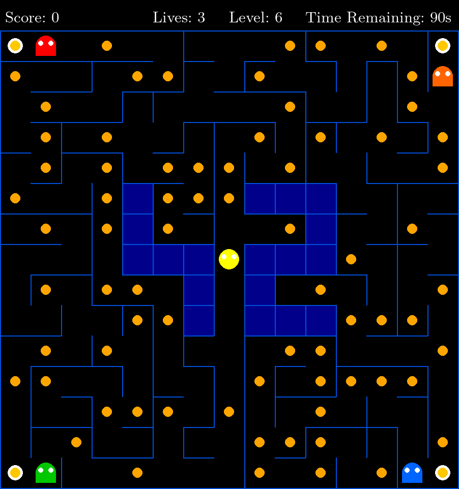

# Pac-Man

[](https://www.python.org/)
[](https://www.pygame.org/)
[](https://yassmarie.itch.io/pacman)

**A complete Pac-Man arcade clone in Python/Pygame**: procedurally generated mazes, four ghosts with
chase/flee AI, 10 timed levels, persistent highscores and a fully config-driven rule set. Ships as a
standalone Linux build.



## Highlights

- **Config-driven gameplay**: a single JSON file (comments supported) controls lives, scoring, level
  sizes, timers, seed and highscore storage. Validated with Pydantic — missing or invalid values fall
  back to safe defaults instead of crashing.
- **Procedural levels**: mazes come from an external `mazegenerator` package behind a `MazeAdapter`;
  each level is regenerated in place with a deterministic seed, so a config always produces the same
  run.
- **Ghost AI**: four ghosts per level with Manhattan-distance chase, frightened flee after a
  super-pacgum, and respawn at their starting positions when eaten.
- **Separation of concerns**: `GameState` owns rules, score and level lifecycle with no Pygame
  dependency; rendering, menus/HUD and persistence are independent modules driven by a small view
  state machine (`menu → playing → paused → name_input`).
- **Persistent highscores**: validated top-10 table stored as JSON, updated as soon as a score is
  entered — no save-on-exit step.
- **Ship-ready**: one-command PyInstaller build and a downloadable Linux release.

## Quick start

Python 3.10+ and [uv](https://docs.astral.sh/uv/):

```bash
git clone https://github.com/imyassmine/pacman.git && cd pacman
make install
make run                        # uses config.json
make run ARGS=my_config.json    # custom config
```

| Key | Action |
| --- | --- |
| Arrows / WASD | Move |
| P / Esc | Pause / resume |
| C | Toggle demo mode (invincible) |
| N (demo mode) | Skip to next level |

## Configuration

Every field is optional and validated; unknown keys are ignored. Main settings:

| Key | Default | Description |
| --- | --- | --- |
| `lives` | `3` | Starting lives |
| `points_per_pacgum` / `points_per_super_pacgum` / `points_per_ghost` | `10` / `50` / `200` | Scoring |
| `level_max_time` | `90` | Time limit per level, in seconds |
| `seed` | `42` | Deterministic generation (`seed + level − 1`) |
| `level` | 10 levels, 14×14 → 15×15 | Level sizes (`width` 14–20, `height` 14–15) |
| `highscore_filename` | `highscore.json` | Highscore store |

A sample is provided in [`config.json`](config.json); the parser also accepts `#`, `//` and `/* */`
comments.

## Architecture

```
src/__main__.py       event loop, input handling, view dispatch
src/core/             GameState, Player, Ghost, collectibles — pure game rules
src/maze/adapter.py   MazeAdapter around the external maze generator
src/ui/               maze rendering, HUD, menus, pause and end screens
src/persistence/      JSON highscore store (validation, top 10)
src/config/           Pydantic models + commented-JSON parser
```

**Stack:** Python 3.10 · Pygame · Pydantic · uv · mypy · flake8 · PyInstaller

**Package:** `make package` → `dist/Pacman/` (standalone Linux build; see `INSTRUCTIONS.txt`).

---
*Built at [42 Paris](https://42.fr) by [Yassmine Abdallah (@imyassmine)](https://github.com/imyassmine)
and mdjigo.*
